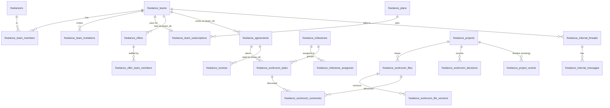

# نموذج البيانات: الفرق والـ Workroom والتعاون (FS-006)

> تصميم بس. **مفيش migration ولا كود اتكتب.** بيبني عليه FS-150 (Workroom) و FS-201..212 (الفرق).
> المدخلات: قرارات FS-001 في [TEAMS-DECISIONS.md](TEAMS-DECISIONS.md) (مقفولة 2026-11-05) والصلاحيات في [PERMISSIONS.md](PERMISSIONS.md).
> **خارج النطاق بقرار FS-002:** أي جداول مستحقات أو توزيع أرباح بين الأعضاء. الفلوس كلها بتدخل محفظة الـ Owner بالمسار الحالي.

## 0) القرارات اللي بتحكم التصميم

| القرار | أثره على الجداول |
|---|---|
| D1 فريق واحد كـ Owner + انضمام لأكتر (حد 5) | `freelance_team_members` unique على (فريق، محترف)؛ حدّ الإنشاء/الانضمام يتحسب من الأدمن مش من قيد. |
| D2 الفريق ككيان والـ Owner قانونيًا | `freelance_agreements.freelancer_id` = الـ Owner (الموقّع)، و`team_id` يوضح إنه اتفاق فريق. |
| D3 تقييم الفريق بس | `freelance_reviews.team_id`، وكل تجميعات التقييم الفردي **تتجاهل** صفوف `team_id` غير الفاضي. |
| D4 توثيق الفريق اختياري والـ Owner موثّق | `freelance_teams.verified_at`، والـ Owner لازم `freelancers.verified_at` موجود. |
| D5 العضو يخرج فورًا | `freelance_team_members.status=left` بدون خطوات موافقة؛ المراحل المسندة بتتفك. |
| D7 حصة الفريق من باقته | `freelance_offers.team_id` + عدّاد حصة على الفريق + `freelance_team_subscriptions`. |
| الحدود ديناميكية من الأدمن | أعمدة حدود قابلة لـ null على `freelance_plans` (null = بلا حد)، مفيش أرقام في الكود. |
| FS-002 تأجيل المالي | مفيش `earnings` لأعضاء. `freelance_earnings` يفضل للـ Owner/المحترف زي ما هو. |

## 1) المخطط (ERD)

الصناديق الرمادية = جداول **موجودة** بتتعدّل بأعمدة nullable. الباقي **جديد**.

## 2) الفرق (FS-2xx)

### `freelance_teams` (جديد)

| عمود | نوع | ملاحظة |
|---|---|---|
| id, uuid | | uuid للـ API |
| name | string(80) | |
| slug | string(100) unique | للرابط العام |
| bio | text null | |
| status | string(20) | `active` · `suspended` (الأدمن) · `archived` |
| visibility | string(10) | `public` · `private` |
| accepting_projects | bool | الطاقة/استقبال المشاريع |
| verified_at | timestamp null | توثيق الفريق (D4، اختياري) |
| rating_avg, rating_count | decimal/uint | **مخزّنة** من الصفوف `team_id` (D3) عشان القراءة سريعة |
| created_by_freelancer_id | FK freelancers | منشئ الفريق (أول Owner) |
| timestamps, deleted_at | | **SoftDeletes** (انظر 7) |

الملفات (الشعار، مستندات التوثيق) في media زي باقي الموديول (`HasMediaTrait`). التخصصات والمهارات: جداول ربط `freelance_team_specialties` / `freelance_team_skills` (مثل `freelance_project_skills`).

### `freelance_team_members`

| عمود | نوع | ملاحظة |
|---|---|---|
| team_id, freelancer_id | FK | **unique** (فريق، محترف) |
| role | string(20) | `owner` · `pm` · `member` (أدوار admin/finance/reviewer لاحقًا، نفس العمود) |
| status | string(20) | `active` · `left` · `removed` |
| permissions | json null | ⚙️ تعديلات لكل عضو (`view_price`, `client_chat`...). null = الافتراضي المقفول. **مفيش `deliver`**: التسليم للعميل للـ Owner بس (D11) |
| joined_at, left_at, left_reason | | |
| removed_by_freelancer_id | FK null | |

> **FS-204 (2026-11-06):** `permissions` بيتخزن فيه بس المفاتيح اللي اختلفت عن افتراضي الدور (`view_price`, `client_chat`, `internal_files`, `invite_members`)، وأي مفتاح تاني يتجاهل عند القراءة. القواعد في `TeamAbilities`.

قواعد **على مستوى الخدمة** (مش قيد DB): فريق فيه Owner `active` واحد على الأقل داخل transaction بقفل صف الفريق؛ آخر Owner ما يخرجش ولا يتحذف (D6)؛ حد الانضمام لكل محترف من الأدمن (D1).
فهارس: `(freelancer_id, status)` لقائمة «فرقي»، `(team_id, status)` للأعضاء.

> **اللي اتنفّذ فعلًا في FS-201 (2026-11-06)** — الفرق عن التصميم أعلاه، وكلها مقصودة (سيرفر بس؛ من غير endpoints ولا شاشات: دعوات FS-203، صلاحيات الأدوار FS-204، شاشات FS-209):
> - **migration واحدة** `2026_11_29_100000_create_freelance_teams` فيها الجداول التلاتة: `freelance_teams` (`uuid, country_id, name, status, created_by_freelancer_id, soft delete`) و`freelance_team_members` و`freelance_team_invitations` (جدول بس، المنطق في FS-203). **اتأجّل لمهامه:** `slug` و`bio` و`visibility` و`accepting_projects` و`verified_at` (توثيق الفريق) وتخصصات/مهارات الفريق → FS-202؛ `rating_*` وأعمدة `team_id` على العروض/الاتفاقات/الشات/التقييمات و`acted_by_freelancer_id` → FS-205 (فيها شرط D3)؛ الباقات والاشتراك → FS-211.
> - **`country_id` اتضاف على `freelance_teams`** (مش في التصميم): دولة منشئ الفريق وقت الإنشاء، وهي اللي بيتقرا منها مفتاح `teams` وحد الأعضاء. مفيش نقل فريق لدولة تانية.
> - **الحدود سياسات أدمن** (`freelance_policies`، نوع `limit`، فاضي = بلا حد) مش أعمدة على الباقة دلوقتي: `teams.owned_max` (الافتراضي **1**، D1) و`teams.joined_max` (الافتراضي **5**، D1) و`teams.members_max` (الافتراضي بلا حد). تفسير D1 اللي اتنفّذ: «Owner لفريق واحد + ينضم لـ 5 غيره» = العدّادين منفصلين؛ `owned` بيعدّ أماكن دور `owner`، و`joined` بيعدّ أماكن `pm`/`member`. الحد بيمنع **الإضافة الجديدة بس** (إنشاء فريق، انضمام، ترقية لـ Owner، أو نزول من Owner لـ PM/عضو لأنه بيتحسب «انضمام») والقديم بيفضل. أعمدة الباقة (`teams_owned_max`…) لو احتجناها تيجي مع FS-211.
> - **الخدمة** `Services/FreelancerTeam/FreelancerTeams` (`create / join / leave / remove / changeRole` + `membership / isMember / isOwner / memberships / limits / maxMembers`)، وكل كتابة بتقفل صف المحترف الأول وبعده صف الفريق. القواعد: Owner `active` واحد على الأقل (D6) — آخر Owner ما يخرجش ولا ينزل ولا يتشال، **ونقل الملكية = ترقية عضو لـ Owner ثم نزول/خروج الأول**. الانضمام بدور `pm` أو `member` بس (الـ Owner بيتعمل بالإنشاء أو `changeRole`). العضو يخرج فورًا (D5) حتى من فريق موقوف/مؤرشف. الـ Owner بس يشيل عضو (ومش نفسه: بيخرج)؛ الفريق الموقوف/المؤرشف/المحذوف ما بياخدش أعضاء ومش بيتغيّر. الصف مش بيتمسح: `left` / `removed` والرجوع بيستخدم نفس الصف (بدور وصلاحيات جديدة).
> - **D4:** إنشاء فريق والانضمام والترقية لـ Owner محتاجين محترف **موثّق** (`FreelancerGate::assertCanApply`، `freelance_verification_required`). توثيق الفريق نفسه (اختياري) في FS-202.
> - **لسه:** حذف/أرشفة الفريق (شرط «ما يتحذفش فريق عنده اتفاق نشط» محتاج `agreements.team_id` — اتضاف في FS-205 ✅، والحذف/الأرشفة نفسها لسه)، والدعوات (FS-203)، ومفتاح `teams` موجود ومقفول افتراضيًا لكن مفيش route بيستخدمه لسه (أول واحد: الشات الداخلي FS-150d).

### `freelance_team_invitations`

`team_id`, `freelancer_id` (null للدعوة برابط)، `token` (unique، للرابط)، `role`, `invited_by_freelancer_id`, `status` (`pending` · `accepted` · `declined` · `expired` · `cancelled`), `expires_at`, `responded_at`. فهرس `(freelancer_id, status)` و`(team_id, status)`. نفس منطق دعوات فريق العميل (انتهاء 7 أيام).

> **FS-203 (2026-11-06):** من غير أعمدة جديدة. دعوة الرابط بتحتفظ بـ `token` وبعد القبول `freelancer_id` = اللي استخدمها. الانتهاء بيتقفل وقت اللمس (`expired`). الدعوة **لأي محترف من أي دولة**. التفاصيل في [API.md](API.md).

### حصة الفريق واشتراكه (D7)

- `freelance_plans` (موجود): عمود جديد `audience` (`freelancer` الافتراضي · `team`)، وأعمدة حدود nullable: `team_members_max`, `team_projects_max`, `teams_owned_max`. **null = بلا حد** (قرار: نفتح الأول ونعمل باقات بعدين من الأدمن).
- `freelance_team_subscriptions` (جديد): نفس شكل `freelance_subscriptions` لكن `team_id` بدل `freelancer_id`، و`paid_by_freelancer_id` (**✅ قرار 2026-11-05: الـ Owner بس هو اللي يشترك من محفظته**؛ مفيش دفع من محفظة عضو تاني ولا محفظة فريق). **مفيش اشتراك = الحصة المجانية الصغيرة** من سياسة جديدة `team_offers_monthly` في `freelance_policies` (الأدمن بيضبطها).
- فواتير: `freelance_subscription_invoices` يتضاف له `team_subscription_id` nullable.
- عدّاد الاستهلاك مش جدول: `count(freelance_offers where team_id = X and free = true في الشهر)`، زي حصة المحترف الحالية.

> **FS-211 (2026-11-07) — اللي اتنفّذ فعلًا** (migration `2026_12_09_100000_create_freelance_team_plans`):
> - `freelance_plans`: `audience` (`freelancer` الافتراضي | `team`) + `team_members_max` + `team_projects_max` (nullable = بلا حد). **`teams_owned_max` ما اتنفّذش** (بيفضل سياسة `teams.owned_max` على المحترف).
> - `freelance_team_subscriptions` بنفس شكل اشتراك المحترف + `paid_by_freelancer_id` (الـ Owner الدافع) + `team_id`؛ فهارس `(team_id,status)` و`(status,period_end)`.
> - **فواتير الفرق في جدول منفصل** `freelance_team_subscription_invoices` بدل عمود `team_subscription_id` على `freelance_subscription_invoices` (قاعدة «ما نلمسش الجدول الشغّال»، وعشان `freelancer_id` عندهم إلزامي)؛ مفاتيحه الأجنبية بأسماء قصيرة بإيدينا (حد MySQL 64 حرف).
> - **اسم السياسة:** `teams.offers_monthly` (من FS-205) بدل `team_offers_monthly`، وسياسة جديدة `teams.projects_max`. الباقة بتزوّد ومش بتنزّل (انظر [API.md «باقة الفريق»](API.md)).
> - الـ migration `down()` بتشيل الجدولين وأعمدة الباقة (متجرّبة up/down/up في `FreelanceTeamPlansTest`).

### تعديلات على جداول موجودة

| الجدول | عمود جديد | سبب |
|---|---|---|
| `freelance_offers` | `team_id` nullable FK, `submitted_by_freelancer_id` nullable | عرض باسم الفريق ومين اللي بعته. `freelancer_id` = الـ Owner. unique (project, freelancer) يفضل: محترف مايقدّمش مرتين على نفس المشروع. |
| `freelance_agreements` | `team_id` nullable FK | اتفاق فريق. `freelancer_id` = الـ Owner الموقّع (D2). |
| `freelance_conversations` | `team_id` nullable FK | شات العميل: Owner + PM بس (PERMISSIONS). الرسائل بتحفظ المرسل الفعلي في `sender_id`. |
| `freelance_reviews` | `team_id` nullable FK | تقييم الفريق (D3). |
| `freelance_project_events`, `freelance_offer_events`, `freelance_milestone_events`, `freelance_project_approvals` | `acted_by_freelancer_id` nullable | المنفّذ الفعلي من الفريق (زي `acted_by_user_id` لجهة العميل). |

> ⚠️ **أخطر نقطة (D3):** `freelance_reviews.freelancer_id` NOT NULL، فتقييم الفريق هيتسجّل على الـ Owner كمحترف. لازم **كل** استعلام تقييم فردي (`FreelanceReviews`، ملف المحترف، السمعة، الترشيح) يضيف `whereNull('team_id')`، وإلا سمعة الـ Owner الفردية هتتضخم بشغل الفريق. ده شرط قبول FS-205 مع اختبار. ✅ **اتنفّذ (2026-11-06):** `stats()` و`latestAbout()` بيستثنوا `team_id` + اختبار بشاهد (نفس الصف من غير `team_id` بيتحسب). `QualityScore` على جهة العميل فمش متأثر.

### `freelance_offer_team_members`

`offer_id`, `freelancer_id`, `role` (`pm` · `executor`), `responsibility` (نص قصير، تقسيم المسؤوليات). unique (offer، محترف). **Snapshot** وقت الإرسال، مش بيتغيّر لو الفريق اتغيّر بعدين. عند تفعيل الاتفاق بيتنسخ لـ `freelance_agreement_team_members` بنفس الشكل (agreement_id)، وده المرجع للمنفّذين الفعليين.

> **اللي اتنفّذ فعلًا في FS-205 (2026-11-06)** — سيرفر بس، والفرق عن التصميم أعلاه:
> - **migration** `2026_12_01_100000_add_team_to_freelance_offers_and_agreements`: `team_id` (FK `nullOnDelete`) على `freelance_offers` (فهرس `(team_id, created_at)` لعدّ حصة الشهر) و`freelance_agreements` (فهرس `(team_id, status)`) و`freelance_reviews`؛ وجدولا `freelance_offer_team_members` و`freelance_agreement_team_members` (`role` pm|executor، `responsibility` ≤200، unique زوجي بأسماء قصيرة عشان حد MySQL 64 حرف). **اتأجّل:** `submitted_by_freelancer_id` (مين بعت) لأن الـ Owner بس هو اللي يبعت دلوقتي — بييجي مع إرسال الـ PM في FS-206؛ و`acted_by_freelancer_id` على الأحداث (FS-206)؛ و`freelance_conversations.team_id` (FS-205 ما لمسش الشات).
> - **الحصة:** سياسة `teams.offers_monthly` (limit، فاضي = بلا حد) على الفريق مش على الـ Owner؛ عرض الفريق `free=false` ومن غير `credit_id` فمش بيلمس حصة الـ Owner الشخصية ولا العروض المشتراة. سحب العرض قبل ما العميل يشوفه بيرجّع المكان. أعمدة باقة الفريق (`offers_monthly` على `freelance_plans`) → FS-211.
> - **اتفاق الفريق:** `freelancer_id` = الـ Owner الموقّع، والباقي (Owners تانيين/PM/أعضاء) **مالهمش وصول للمشروع** لحد FS-206؛ الـ API بيعرض الفريق والناس للعميل بالاسم الأول + الدور + المسؤولية بس (D10).
> - ✅ **اتقفل 2026-11-06:** `completed_projects` و`completion_rate` و`on_time_rate` و`similar_projects` في `FreelanceReviews::stats` بقت بتستثني اتفاقات الفريق (D3 على كل الأرقام)، وأرقام الفريق من `FreelanceReviews::teamStats($team)` (لملف الفريق FS-202).

> **FS-202b (2026-11-06):** migration `2026_12_08_100000_create_freelance_team_verification`:
> - **`freelance_team_verification_requests`**: `uuid, team_id, submitted_by_freelancer_id, status (submitted|approved|rejected), submitted_at, decided_at, decided_by_admin_id, reason`.
> - **`freelance_team_verification_documents`**: `uuid, team_id, request_id (null = لسه ما اتبعتش), uploaded_by_freelancer_id, title`، والملف media على القرص الخاص.
> - الموافقة بتحط `freelance_teams.verified_at`. بدون مصفوفة متطلبات لكل دولة ولا انتهاء.
>
> **FS-202a (2026-11-06):** migration `2026_12_07_100000_add_profile_to_freelance_teams`:
> - **`freelance_teams`:** `bio` (text null)، `visibility` (`public|private`، الافتراضي `private`)، `accepting_projects` (bool، الافتراضي true)، `verified_at` (FS-202b). الشعار media `logo` على الفريق.
> - **`freelance_team_members.show_in_profile`** (bool، الافتراضي false): موافقة العضو على ظهوره (D10).
> - **`freelancer_portfolio_items.team_id`** (FK null، cascade): عمل ملك الفريق.
>
> **الفرق عن التصميم:**
> - مفيش `slug`: الرابط بالـ uuid زي باقي الموديول.
> - مفيش `rating_*` مخزّنة: بتتحسب من `teamStats`.
> - مفيش جداول `freelance_team_specialties` / `_skills`: التخصصات والمهارات واللغات اتحاد الأعضاء (D10)، فمفيش حاجة تتخزّن أو تتقادم.
>
> **FS-208 (2026-11-06):** `status_reason` (string 255 null) و`status_changed_at` (timestamp null) على `freelance_teams` — سبب إيقاف الإدارة ووقته؛ migration `2026_12_06_100000_add_status_reason_to_freelance_teams`.
>
> **FS-207 (2026-11-06):** `scope` (`shared` | `team`، افتراضي `shared`) على `freelance_workroom_files` و`freelance_workroom_comments` (الملاحظة بتاخد scope الملف)، والمهام كان عندها من FS-150a — migration `2026_12_05_100000_add_scope_to_freelance_workroom_files_and_comments`. أحداث العناصر الداخلية في `freelance_project_events` بـ `audience=team`.
>
> **FS-206c (2026-11-06):** `submitted_by_freelancer_id` (nullable، من غير FK) على `freelance_offers` — الـ PM اللي بعت عرض الفريق للـ Owner الموقّع (`freelancer_id`)؛ migration `2026_12_04_100000_add_submitted_by_to_freelance_offers`.
>
> **FS-206a (2026-11-06):** `acted_by_freelancer_id` (nullable، من غير FK زي `acted_by_user_id`) على `freelance_project_approvals` و`freelance_project_events` و`freelance_milestone_events` و`freelance_offer_events` — migration `2026_12_02_100000_add_acted_by_freelancer_to_freelance_records`. الوصول نفسه من غير جداول: Owner/PM من دورهم في الفريق، والعضو من `freelance_agreement_team_members` (أو ناس العرض قبل التفعيل) لحد ما الإسناد ييجي في FS-206b. التفاصيل في [API.md](API.md) «وصول الفريق لمشروع الفريق».

### `freelance_milestone_assignees` (FS-206)

`milestone_id`, `freelancer_id`, `assigned_by_freelancer_id` null, unique زوجي (`freelance_milestone_assignees_pair_unique`). العضو اللي يخرج (D5) بتتفك مراحله ومهامه تلقائيًا ويتبلّغ الـ Owners (مفيش قفل مراحل). ✅ **FS-206b (2026-11-06):** migration `2026_12_03_100000_create_freelance_milestone_assignees` (+ `assignee_freelancer_id` على `freelance_workroom_tasks` بفهرس `(assignee_freelancer_id, status)`، من غير FK). اللي مُسند يوصل للمشروع (D9).

## 3) Workroom (FS-150)

كل الجداول مربوطة بـ `project_id` (وعادة `agreement_id`)، مع عمود **`scope`**: `shared` (العميل والمحترف يشوفوه) أو `team` (داخلي للفريق، العميل ما يشوفوهوش). المشروع الفردي بيستخدم `shared` بس.

### `freelance_workroom_tasks` (FS-150a)

`uuid`, `project_id`, `agreement_id`, `milestone_id` null, `title(160)`, `description` null, `status` (`todo` · `doing` · `done` · `blocked`), `position`, `due_on` null, `scope`, الإسناد: `assignee_side` (`client` · `freelancer`) + `assignee_user_id` null + `assignee_freelancer_id` null (أحدهم بس، مفروض بالخدمة), `created_by_type/id`, `completed_at`. فهارس: `(project_id, status)`, `(assignee_freelancer_id, status)`, `(milestone_id)`.

> **اللي اتنفّذ فعلًا في FS-150a (2026-11-05)** — الفرق عن التصميم أعلاه، وكلها مقصودة:
> - الإسناد **لطرف بس** (`assignee_side` = عميل أو محترف). أعمدة `assignee_user_id` / `assignee_freelancer_id` **اتأجّلت لـ FS-206** (إسناد لعضو فريق)، بتتضاف nullable بمigration صغير.
> - **من غير `position`**: الترتيب بالحالة ثم أقرب يوم ثم `id`. بيتضاف لما يبقى فيه سحب وإعادة ترتيب في الشاشة.
> - `created_by_type` اتسمّى `created_by_side` (عميل/محترف) + `created_by_id`.
> - **Soft delete** (`deleted_at`) لأن سجل المشروع بيشاور على المهمة. فهارس: `(agreement_id, status)`, `(project_id, id)`, `(milestone_id)`.
> - `scope` موجود بقيمة `shared` بس لحد الفرق (FS-207).
> - الحد: مفتاح السياسة اسمه `workroom.tasks_max` (بنفس نمط باقي المفاتيح، مش `workroom_tasks_max`)، ونوعه الجديد `limit` (رقم أو فاضي = من غير حد)، وبيتعدّ لكل **مشروع**.

### `freelance_workroom_files` + `freelance_workroom_file_versions` (FS-150b)

- الملف المنطقي: `uuid`, `project_id`, `milestone_id` null, `name`, `scope`, `current_version_id` null, `created_by_*`, `archived_at`.
- النسخة (**لا تتعدّل ولا تتحذف**): `file_id`, `number` (unique مع الملف), `note`, `size`, `mime`, `scan_status`، والملف نفسه media على القرص الخاص. بيمر بنفس فحص الرفع الحالي (`uploads` والـ ClamAV الاختياري، FL-1205) وحد الحجم `upload_max_kb`.
- تحميل الملف للطرفين بس (مثل `deliveries/{delivery}/files/{media}`).

> **اللي اتنفّذ فعلًا في FS-150b (2026-11-06)** — الفرق عن التصميم أعلاه، وكلها مقصودة:
> - الملف المنطقي: `title` (مش `name`) + `description` + `versions_count` (عدّاد الإصدارات، بيتزوّد تحت قفل). **من غير `current_version_id`** (الإصدار الأحدث = أعلى `number`)، **ومن غير `scope`** لحد الفرق (FS-207). `agreement_id` اتضاف زي المهام. `created_by_type` → `created_by_side` + `created_by_id`.
> - **المسح = soft delete** (`deleted_at`) بدل `archived_at`: الملف وإصداراته وملاحظاته بتتخفي والبايتات بتفضل على القرص للسجل/النزاع. المسح بيرجّع المساحة من حد `workroom.storage_mb`.
> - الإصدار: `uuid`, `file_id`, `number` (unique مع الملف), `note(500)`, `original_name`, `mime_type`, `size_bytes`, `created_by_side/id`, `created_at` (من غير `updated_at`: **لا يتعدّل**). **من غير `scan_status`**: الفحص بيتم **قبل** الحفظ (`CleanUpload`)، والملف المرفوض ما بيتحفظش أصلًا، فمفيش حالة وسط تتخزن.
> - الإصدارات بيضيفها **صاحب الملف بس** (الأضيق: التوسيع بعدين سهل، والتضييق صعب). الطرف التاني بيعلّق. أقصى 50 إصدار للملف (حماية).
> - **مفاتيح السياسة:** `workroom.files_max` و`workroom.storage_mb` (نوع `limit`، فاضية = بلا حد) — بنفس نمط `workroom.tasks_max`.
> - **FL-L13:** ملف المحترف المربوط بمرحلة لسه ما اتعتمدتش = معاينة بس للعميل لو الاتفاق له `rights` (نفس `MilestoneDeliveries::previewOnly`). راجع القسم 9 (#5).

### `freelance_workroom_comments`

`uuid`, `project_id`, `subject_type` (`task` · `file` · `delivery` · `decision`), `subject_id`, `scope`, `body(2000)`, `author_type/id`, `created_at`, `edited_at`, `deleted_at`. تعليقات الملف ممكن تتربط بنسخة (`file_version_id` null). فهرس `(subject_type, subject_id, id)`.

> **اللي اتنفّذ فعلًا في FS-150b (2026-11-06):** بدل `subject_type/subject_id` العامين اتعمل **مفتاحين أجنبيين صريحين** `file_id` / `delivery_id` (واحد بس منهم، مفروض بالخدمة) عشان سلامة العلاقات و`cascade` — والتعليق على نسخة = `version_number` (رقم الإصدار) مش `file_version_id`. التعليق على **مهمة / قرار** لسه (قرار = FS-150c؛ المهمة ممكن تتضاف بنفس الشكل لو اتطلبت). `author_type/id` → `author_side` + `author_id`. soft delete + `edited_at`. الكاتب (الطرف) هو اللي يعدّل ويمسح.

### `freelance_workroom_decisions` (FS-150c)

`uuid`, `project_id`, `milestone_id` null, `title`, `body`, `status` (`proposed` · `agreed` · `superseded`), `recorded_by_*`, `client_ack_at`, `freelancer_ack_at`, `supersedes_id` null. القرار المتفق عليه **ما يتعدّلش**: بيتعمل قرار جديد بـ `supersedes_id`.

> **اللي اتنفّذ فعلًا في FS-150c (2026-11-06)** — الفرق عن التصميم أعلاه، وكلها مقصودة:
> - **حالة رابعة `declined`** (الطرف التاني رفض الاقتراح) — من غيرها مفيش طريقة يتسجل بيها إن الاقتراح اتردّ بـ"لأ". القرار المرفوض بيفضل في السجل ومش بيتبدّل.
> - `recorded_by_*` اتسمّى `proposed_by_side` + `proposed_by_id` (اللي **اقترح**، لأن القرار بيتسجل متفق عليه بعد رد التاني). اللي اقترح موافق بمجرد الاقتراح (`<side>_ack_at` بيتملّى معاه)، والرد بيملّى الطرف التاني + `answered_at`.
> - عمودين جداد: `answer_note(300)` (ملاحظة اختيارية مع الموافقة/الرفض) و`answered_at`. `agreement_id` اتضاف زي المهام والملفات. soft delete عشان **سحب الاقتراح** (للي اقترح، وهو لسه مستني بس) من غير ما سجل المشروع يشاور على صف مش موجود.
> - القرار **مش بيغيّر فلوس ولا مراحل**؛ ده مسار طلب التغيير (FL-405). `milestone_id` اختياري ومجرد ربط للعرض والفلترة.
> - **القرار اللي اتردّ عليه ما بيتعدّلش ولا بيتسحب.** تغييره = قرار جديد بـ `supersedes_id` (لازم يشاور على قرار `agreed` من نفس المشروع)، ولما الجديد يتوافق عليه القديم بيبقى `superseded` (+ حدث `workroom.decision.superseded`).
> - التعليق على القرار (`freelance_workroom_comments`) **مؤجّل**: القرار فيه `body` وملاحظة الرد، والنقاش بيتم في الشات. بيتضاف بنفس شكل ملاحظات الملف (مفتاح أجنبي `decision_id`) لو اتطلب.

### الـ Timeline في FS-150c (اللي اتنفّذ)

- اتضاف عمود **`audience`** (`both` | `client` | `freelancer` | `team`، الافتراضي `both`) على `freelance_project_events` + فهرس `(project_id, audience, id)`. `FreelanceProjectEvent::scopeVisibleTo($side)` / `isVisibleTo($side)`. كل طرف بيشوف `both` + اللي لطرفه بس؛ `team` ما بيوصلش للعميل. **مفيش كود بيكتب غير `both` لحد دلوقتي** (بيتفعّل مع الشات الداخلي FS-150d وملفات الفريق FS-207).
- **مفيش جدول جديد للـ Timeline**: `WorkroomTimeline` بيجمع **في الذاكرة** أحداث الـ Workroom (`workroom.*` من `freelance_project_events`) + سجل موافقات الاتفاق (`ApprovalTrail`، FL-406)، مرتّبين الأحدث الأول، حد أقصى 500 صف من كل مصدر. الـ payload بيتفلتر لمفاتيح آمنة بس، ومفيش نص كتبه الطرفين ولا مبالغ فيه.

### Timeline / Activity Log

**مفيش جدول جديد.** بنستخدم `freelance_project_events` (موجود) ونضيف له:
- `audience` (`both` افتراضي · `client` · `freelancer` · `team`) عشان حدث داخلي للفريق ما يظهرش للعميل،
- أنواع أحداث جديدة (`workroom.task.*`, `workroom.file.*`, `workroom.decision.*`).
الـ Timeline شاشة تقرأ الأحداث + أحداث المراحل. كل حدث ينزل حدث لحظي (Pusher) للطرف المعني، من غير Polling.

## 4) الفصل بين شات العميل والداخلي (FS-150d)

- **شات العميل:** `freelance_conversations/messages` زي ما هي (+`team_id`). دليل نزاع بالفعل (بلاغات الرسائل الموجودة).
- **داخلي للفريق:** جداول منفصلة عشان `freelance_conversations.client_id` NOT NULL:
  - `freelance_internal_threads`: `uuid`, `team_id`, `project_id` null (null = محادثة فريق عامة), `title` null.
  - `freelance_internal_messages`: `thread_id`, `sender_freelancer_id`, `kind`, `body`, `client_msg_id` (dedupe)، `created_at`, `deleted_at`.
  - `freelance_internal_reads`: `thread_id`, `freelancer_id`, `last_read_message_id`.
- **خصوصية (✅ قرار نهائي 2026-11-05):** الأدمن **يشوف الشات الداخلي في النزاعات بس**، من غير ما يحتاج موافقة الفريق. ضوابط التصميم:
  - **قراءة فقط**، ولمشروع فيه نزاع **مفتوح** (`freelance_disputes` بحالة مفتوحة) وعلى خيوط `project_id` بتاعة المشروع ده بس. المحادثة العامة للفريق (`project_id = null`) وشات مشاريع تانية **مش متاحة**.
  - كل فتح بيتسجّل في `AuditLog` الموجود (`App\Models\AuditLog`، فعل `freelance.internal_chat.viewed`، الأدمن + المشروع + النزاع)، ويظهر في شاشة `freelance-audit`. **مفيش جدول جديد.**
  - بصلاحية أدمن مستقلة (مش بتتوزّع مع صلاحية النزاعات العادية).
  - **الشفافية:** الفريق يتنبّه في الشاشة (عند فتح الخيط وعند إنشاء الفريق) إن الأدمن ممكن يراجع محادثات مشروع فيه نزاع. ويتبلّغ الـ Owner لما يتفتح خيط لنزاع.
  - الفريق يفضل يقدر **يرفق رسائل** كدليل بإرادته (`freelance_dispute_evidence`)، بس مش شرط عشان الأدمن يشوفها.

> **اللي اتنفّذ فعلًا في FS-150d (2026-11-06)** — سيرفر بس (الشاشات FS-150e/FS-209، وشاشة الأدمن FS-150f)، والفرق عن التصميم أعلاه:
> - migration `2026_11_30_100000_create_freelance_internal_chat`: `freelance_internal_threads` (`uuid, team_id, project_id?, created_by_freelancer_id?, last_message_at, last_message_preview`، unique `(team_id, project_id)`)، `freelance_internal_messages` (`thread_id, sender_freelancer_id, kind=text, body?, client_msg_id?, created_at, deleted_at?`، unique `(thread, sender, client_msg_id)`)، `freelance_internal_reads` (`thread_id, freelancer_id, last_read_message_id`). **من غير `title`**: خيط عام واحد للفريق + خيط واحد لكل مشروع (مواضيع متعددة لو اتطلبت بعدين).
> - **خيط المشروع** بيفتحه **Owner** لمشروع اتفاقه (`active` أو `completed`) موقّع من واحد من Owners الفريق (لحد ما `agreements.team_id` ييجي في FS-205). **كل أعضاء الفريق النشطين بيقروا ويكتبوا كل خيوطه** (D9 «العضو يشوف المشاريع المسند عليها بس» لسه مقترح، بيتطبق مع الإسناد FS-206).
> - **نص بس** (الملفات مع مساحة الفريق FS-207). نفس قواعد شات العميل: `client_msg_id` ضد التكرار، السحب للمرسل خلال 5 دقايق، عقوبة `chat` بتوقف الإرسال. الفريق الموقوف/المؤرشف أو مفتاح `teams` المقفول في دولة الفريق = قراءة بس.
> - **«النزاع المفتوح» = `open` أو `appealed`** (الحالتين اللي الإدارة بتحسم فيهم). `decided` و`resolved` = مقفول على الإدارة.
> - **الحذف وقت النزاع:** الرسالة اللي صاحبها سحبها وخيطها لمشروع عليه نزاع `open/appealed` **نصها بيفضل في الجدول للإدارة بس** (الفريق بيشوفها «اتمسحت»). غير كده النص بيتمسح فعلًا. نزاع بيتفتح بعد السحب ما بيرجّعش نص اتمسح.
> - **الأدمن:** `GET /api/admin/v1/freelance-disputes/{uuid}/internal-chat` بصلاحية مستقلة `freelance-internal-chat.view` (مش مع `freelance-disputes`)؛ خيوط المشروع ده بس (من أي فريق)، الأقدم الأول، 500 رسالة للخيط؛ كل فتح بيتسجّل `freelance.internal_chat.viewed` في `AuditLog`، وأول مرة لكل نزاع الـ Owners بيتبلّغوا (`freelance.internal_chat_reviewed`). شاشات الفريق بتعرض نص الشفافية (`notice`) و`under_review` على خيط المشروع وقت النزاع.
> - **مش متنفّذ:** إرفاق رسائل داخلية كدليل نزاع (`freelance_dispute_evidence`) — بإرادة الفريق، يتضاف مع الشاشات؛ و`audience=team` على أحداث المشروع لسه مش مستخدم (الشات مش بيكتب أحداث مشروع).

## 5) فريق العميل (FS-104) — موجود، للربط فقط

`freelance_project_members` (دور وتفويض) + `acted_by_user_id`. الربط الوحيد الجديد: في اتفاق فريق، **العميل يشوف الفريق** (اسم + أعضاء منفّذين من `freelance_agreement_team_members`) في FS-210 (✅ اتنفّذ 2026-11-07 في تطبيقات العميل، من غير أي تغيير في السيرفر)، من غير بيانات خاصة بالأعضاء (D10: عرض بيانات العضو بموافقته).

## 6) الأداء والفهارس

- كل جدول جديد فيه فهرس على المفاتيح اللي بتتسأل بيها الشاشة: `(project_id, status)` للمهام، `(team_id, status)` للأعضاء والدعوات، `(freelancer_id, status)` لـ «فرقي».
- الاستعلامات الثقيلة (حصة الفريق الشهرية، التقييم) على أعمدة/عدّادات مخزّنة أو فهارس مركّبة، مش `count(*)` على جداول كبيرة بدون فهرس (`freelance_offers (team_id, created_at)`).
- JSON (`permissions`) للمرونة بس؛ أي حقل بنفلتر بيه يبقى عمود.
- ترتيب الصفوف دايمًا بـ `id` (زي باقي الموديول) للصفحات.

## 7) سياسة الحذف والاحتفاظ

| بيانات | سياسة |
|---|---|
| `freelance_teams` | SoftDeletes. **ما يتحذفش فريق عنده اتفاق نشط.** الحذف النهائي بعد انتهاء كل اتفاقاته + مدة احتفاظ من الأدمن. |
| `freelance_team_members` | ما بتتحذفش؛ `status=left/removed` + `left_at` (Audit). |
| نسخ ملفات الـ Workroom، القرارات، سجل الأحداث | **لا تتعدّل ولا تتحذف** (دليل نزاع). الإخفاء بـ `archived_at` بس. |
| رسائل الشات الداخلي | Soft delete للرسالة (`deleted_at`) من صاحبها خلال مدة قصيرة؛ الأدمن مش بيحذف. **الرسالة المحذوفة في مشروع فيه نزاع مفتوح بيفضل نصها محفوظ** للأدمن (قراءة فقط) زي تعليقات Workroom. |
| تعليقات Workroom | Soft delete، والنص الأصلي بيتحفظ في الـ Audit لو اتحذف بعد مشروع مفتوح فيه نزاع. |
| حذف حساب محترف عضو | تتفك مراحله، يخرج من الفرق، وصفوفه التاريخية بتفضل (المنفّذ الفعلي) من غير بيانات شخصية. |

## 8) خطة الـ Migrations (من غير كسر المشاريع الجارية)

القاعدة: **كل تعديل على جدول موجود = عمود nullable بدون default يغيّر السلوك**، ومفيش backfill. اتفاقات ومشاريع وعروض اليوم بتفضل `team_id = null` وسلوكها ما بيتغيّرش.

ترتيب ملفات الـ migration (اسم بنفس نمط الموديول، تواريخ بعد `2026_11_25`):
1. `create_freelance_teams` (الفريق، الأعضاء، الدعوات، التخصصات/المهارات).
2. `add_team_to_freelance_core` (أعمدة `team_id` / `acted_by_freelancer_id` / `submitted_by_freelancer_id`، وفهارسها).
3. `create_freelance_team_offer_staff` (`offer_team_members`, `agreement_team_members`, `milestone_assignees`).
4. `create_freelance_team_plans` (`audience` وحدود الباقات، `team_subscriptions`، عمود الفواتير، سياسة `team_offers_monthly`).
5. `create_freelance_workroom` (المهام، الملفات والنسخ، التعليقات، القرارات، `audience` على الأحداث).
6. `create_freelance_internal_chat` (الخيوط والرسائل والقراءة).

كل migration: `down()` يعكس بالكامل (آخر عمود يتضاف أول ما يتشال)، ومعاه اختبار تشغيل `up` ثم `down` ثم `up`. كل ميزة وراها مفتاح تشغيل لكل دولة: `teams` و`workroom` (يتضافوا في `FreelanceFeatures::FEATURES`، ومقفولين افتراضيًا لحد ما الأدمن يفتحهم).

## 9) القرارات اللي اتحسمت لهذا التصميم (صاحب المشروع، 2026-11-05)

| # | السؤال | القرار | الأثر |
|---|---|---|---|
| 1 | مين بيدفع اشتراك الفريق الاختياري؟ | ✅ **محفظة الـ Owner بس** | `freelance_team_subscriptions.paid_by_freelancer_id` = الـ Owner دايمًا. مفيش محفظة فريق. بيقفل النقطة المفتوحة في D7 (TEAMS-DECISIONS). |
| 2 | الأدمن والشات الداخلي في النزاع | ✅ **يشوفه في النزاعات بس، من غير موافقة الفريق** | قراءة فقط + `AuditLog` + تنبيه شفافية للفريق (القسم 4). |
| 3 | جدول اشتراك الفريق | ✅ **جدول منفصل** `freelance_team_subscriptions` | مفيش تعديل على `freelance_subscriptions` الشغّال. |
| 4 | حدود Workroom لكل مشروع | ✅ **سياسات أدمن، مفتوحة (بلا حد) في الأول** | مفاتيح جديدة في `freelance_policies.data` (لكل دولة/تخصص)، القيمة الفاضية = بلا حد: `workroom_tasks_max`, `workroom_files_max`, `workroom_storage_mb`. حجم الملف الواحد يفضل على `upload_max_kb`. مفيش أرقام في الكود، والأدمن يضبطها لاحقًا. تخطّي الحد يمنع **الإضافة الجديدة بس** ولا يمسح ولا يقفل مشروع جاري. |

| 5 | ملفات Workroom وحماية الشغل قبل الدفع (FL-L13) | ✅ **اتأكد 2026-11-06: نثبّت التصميم ده** | ملف **المحترف** المربوط بمرحلة لسه ما اتعتمدتش، والاتفاق له شروط حقوق = **معاينة بس** للعميل (نفس قاعدة التسليم). ملف من غير مرحلة أو ملف العميل = تحميل عادي. يعني الـ Workroom ما بيفتحش شغل التسليم بيقفله لحد الاعتماد. البديل (لو عايزه): تحميل عادي لكل ملفات الـ Workroom والحماية على التسليم بس — تغييره سطرين في `WorkroomFiles::previewOnly`. |
| 6 | مين يسلّم الشغل للعميل في فريق؟ | ✅ **الـ Owner (المسؤول عن الفريق) بس** (2026-11-06) | **مفيش أعمدة جديدة**: `freelance_deliveries` يفضل من غير `submitted_by` لأن اللي سلّم دايمًا `agreement.freelancer_id` (الـ Owner الموقّع، D2). `permissions.deliver` اتشال من أمثلة تعديلات العضو. مفيش «تسليم داخلي» إجباري ولا جدول له: رفع الأعضاء (اختياري وبإذن الـ Owner، في مساحة الفريق الداخلية `scope=team`، FS-207) ما بيتحسبش تسليم ولا بيوصل للعميل، والـ Owner هو اللي يرفع ملفات التسليم بنفسه. خدمة التسليم تتأكد إن المنفّذ هو Owner الفريق الحالي وترد 403 غير كده. |

**مفيش أسئلة مفتوحة لهذا التصميم دلوقتي.**

## 10) ربط بالمهام

| المهمة | الجداول |
|---|---|
| FS-150a/b/c | tasks، files + versions، comments، decisions، `audience` على الأحداث |
| FS-150d | الشات الداخلي (القسم 4) |
| FS-150f | قراءة أدمن للـ Workroom المشترك (`scope=shared`)، وللشات الداخلي **في النزاع المفتوح بس** بقراءة فقط + `AuditLog` (القسم 4) |
| FS-201 | teams، members، invitations، plans/subscriptions للفريق |
| FS-203 | invitations + أحداث الانضمام/الخروج |
| FS-205 | `offers.team_id`، `offer_team_members`، `agreements.team_id`، حصة الفريق، `reviews.team_id` |
| FS-206 | `milestone_assignees` + مهام Workroom المسندة |
| FS-208/209/210 | قراءة نفس الجداول (أدمن، تطبيق المحترف، تطبيق العميل) |
